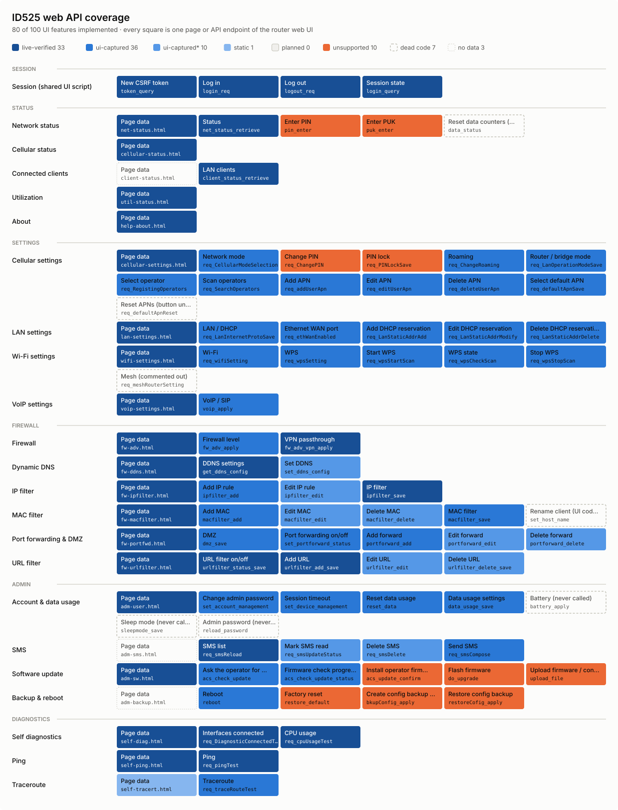

# python-id525

Async Python client for the **General Mobile ID525** 5G FWA router (sold in
Italy by TIM as *FWA 5G*), talking to the same JSON/CGI API the router's web UI
uses. **Read-only by default**; configuration changes are opt-in.

> Unofficial project, not affiliated with General Mobile or TIM.

## Features

- Network status: SIM/registration state, signal level, operator, connection
  time, data counters, WAN IPv4/IPv6, Wi-Fi state and client counts, Ethernet
  link speeds.
- Serving cells: 4G/5G band, bandwidth, PCI, ARFCN, cell id, RSRP/RSRQ/SNR.
- Utilisation: CPU and memory (current/min/max), uplink/downlink throughput,
  uptime.
- Device info: model, hardware/software version, IMEI, IMSI, phone number, APNs.
- LAN client list (hostname, MAC, IP, interface).
- SMS store (never marks messages as read).
- LAN settings and DHCP reservations (add / edit / delete), reboot.
- Fully typed (`py.typed`), `asyncio` + `aiohttp`, no other dependencies.

## Coverage

Every page and API endpoint of the router web UI, and how far this library
supports it. Generated from the code (`id525.endpoints` + the client methods),
so it is always current.

<!-- coverage:start -->
<!-- generated by `uv run python -m tools.coverage_map`; do not edit by hand -->
<picture>
  <source media="(prefers-color-scheme: dark)" srcset="docs/coverage-dark.svg">
  
</picture>

| Status | Meaning | Count |
|---|---|---:|
| 🟦 live-verified | observed on a real router (read-only probes, user traces) | 12 |
| 🔵 ui-captured | byte-identical to the router UI, captured offline | 43 |
| 🔷 ui-captured* | as ui-captured, from invented page data (the real dump had no rows) | 10 |
| 🔹 static | implemented from the UI code, not captured | 15 |
| ⬜ planned | not implemented yet | 0 |
| 🟧 unsupported | deliberately not implemented: raises NotImplementedError | 10 |
| ▫️ dead code | never called by the UI | 7 |
| ◽ no data | page holds no data beyond what an endpoint returns | 3 |

<details><summary>Every page and endpoint</summary>

| Page | Feature | Endpoint | Kind | Status | Client |
|---|---|---|---|---|---|
| Session (shared UI script) | New CSRF token | `token_query` | session | 🟦 live-verified | `keep_alive()` |
| Session (shared UI script) | Log in | `login_req` | session | 🟦 live-verified | `ensure_session()` |
| Session (shared UI script) | Log out | `logout_req` | session | 🟦 live-verified | `logout()` |
| Session (shared UI script) | Session state | `login_query` | session | 🟦 live-verified | `ensure_session()` |
| Network status | Page data | `net-status.html` | read | 🔹 static | `status.get_sim_pin_status()` |
| Network status | Status | `net_status_retrieve` | read | 🟦 live-verified | `get_network_status()` |
| Network status | Enter PIN | `pin_enter` | write | 🟧 stub-policy | `cellular.enter_pin()` |
| Network status | Enter PUK | `puk_enter` | write | 🟧 stub-policy | `cellular.enter_puk()` |
| Network status | Reset data counters (never called) | `data_status` | write | ▫️ dead-code |  |
| Cellular status | Page data | `cellular-status.html` | read | 🟦 live-verified | `get_cellular_info()` |
| Connected clients | Page data | `client-status.html` | read | ◽ no-data |  |
| Connected clients | LAN clients | `client_status_retrieve` | read | 🟦 live-verified | `get_clients()` |
| Utilization | Page data | `util-status.html` | read | 🟦 live-verified | `get_utilization()` |
| About | Page data | `help-about.html` | read | 🟦 live-verified | `get_device_info()` |
| Cellular settings | Page data | `cellular-settings.html` | read | 🔹 static | `cellular.add_apn()` |
| Cellular settings | Network mode | `req_CellularModeSelection` | write | 🔵 ui-captured | `cellular.set_network_mode()` |
| Cellular settings | Change PIN | `req_ChangePIN` | write | 🟧 stub-policy | `cellular.change_pin()` |
| Cellular settings | PIN lock | `req_PINLockSave` | write | 🟧 stub-policy | `cellular.set_pin_lock()` |
| Cellular settings | Roaming | `req_ChangeRoaming` | write | 🔵 ui-captured | `cellular.disable_roaming()` |
| Cellular settings | Router / bridge mode | `req_LanOperationModeSave` | destructive | 🔵 ui-captured | `cellular.set_operation_mode()` |
| Cellular settings | Select operator | `req_RegistingOperators` | write | 🔵 ui-captured | `cellular.register_operator()` |
| Cellular settings | Scan operators | `req_SearchOperators` | action | 🔵 ui-captured | `cellular.register_operator()` |
| Cellular settings | Add APN | `req_addUserApn` | write | 🔵 ui-captured | `cellular.add_apn()` |
| Cellular settings | Edit APN | `req_editUserApn` | write | 🔵 ui-captured | `cellular.edit_apn()` |
| Cellular settings | Delete APN | `req_deleteUserApn` | write | 🔵 ui-captured | `cellular.delete_apn()` |
| Cellular settings | Select default APN | `req_defaultApnSave` | write | 🔵 ui-captured | `cellular.set_default_apn()` |
| Cellular settings | Reset APNs (button unbound) | `req_defaultApnReset` | destructive | ▫️ dead-code |  |
| LAN settings | Page data | `lan-settings.html` | read | 🟦 live-verified | `lan.add_dhcp_reservation()` |
| LAN settings | LAN / DHCP | `req_LanInternetProtoSave` | destructive | 🔵 ui-captured | `lan.update_settings()` |
| LAN settings | Ethernet WAN port | `req_ethWanEnabled` | destructive | 🔵 ui-captured | `lan.set_ethernet_port_role()` |
| LAN settings | Add DHCP reservation | `req_LanStaticAddrAdd` | write | 🔵 ui-captured | `lan.add_dhcp_reservation()` |
| LAN settings | Edit DHCP reservation | `req_LanStaticAddrModify` | write | 🔵 ui-captured | `lan.modify_dhcp_reservation()` |
| LAN settings | Delete DHCP reservation | `req_LanStaticAddrDelete` | write | 🔵 ui-captured | `lan.delete_dhcp_reservation()` |
| Wi-Fi settings | Page data | `wifi-settings.html` | read | 🟦 live-verified | `wifi.get_settings()` |
| Wi-Fi settings | Wi-Fi | `req_wifiSetting` | write | 🔵 ui-captured | `wifi.set_mlo()` |
| Wi-Fi settings | WPS | `req_wpsSetting` | write | 🔵 ui-captured | `wifi.set_mlo()` |
| Wi-Fi settings | Start WPS | `req_wpsStartScan` | action | 🔵 ui-captured | `wifi.start_wps()` |
| Wi-Fi settings | WPS state | `req_wpsCheckScan` | action | 🔵 ui-captured | `wifi.start_wps()` |
| Wi-Fi settings | Stop WPS | `req_wpsStopScan` | action | 🔵 ui-captured | `wifi.stop_wps()` |
| Wi-Fi settings | Mesh (commented out) | `req_meshRouterSetting` | write | ▫️ dead-code |  |
| VoIP settings | Page data | `voip-settings.html` | read | 🔹 static | `voip.get_settings()` |
| VoIP settings | VoIP / SIP | `voip_apply` | write | 🔵 ui-captured | `voip.update()` |
| Firewall | Page data | `fw-adv.html` | read | 🔹 static | `firewall.get_settings()` |
| Firewall | Firewall level | `fw_adv_apply` | write | 🔵 ui-captured | `firewall.set_level()` |
| Firewall | VPN passthrough | `fw_adv_vpn_apply` | write | 🔵 ui-captured | `firewall.set_vpn_passthrough()` |
| Dynamic DNS | Page data | `fw-ddns.html` | read | 🔹 static | `ddns.get_settings()` |
| Dynamic DNS | DDNS settings | `get_ddns_config` | read | 🔹 static | `ddns.get_settings()` |
| Dynamic DNS | Set DDNS | `set_ddns_config` | write | 🔷 ui-captured-synthetic | `ddns.set_settings()` |
| IP filter | Page data | `fw-ipfilter.html` | read | 🔹 static | `ip_filter.add_rule()` |
| IP filter | Add IP rule | `ipfilter_add` | write | 🔵 ui-captured | `ip_filter.add_rule()` |
| IP filter | Edit IP rule | `ipfilter_edit` | write | 🔷 ui-captured-synthetic | `ip_filter.edit_rule()` |
| IP filter | IP filter | `ipfilter_save` | write | 🔵 ui-captured | `ip_filter.delete_rule()` |
| MAC filter | Page data | `fw-macfilter.html` | read | 🔹 static | `mac_filter.add_connected_client()` |
| MAC filter | Add MAC | `macfilter_add` | write | 🔵 ui-captured | `mac_filter.add_connected_client()` |
| MAC filter | Edit MAC | `macfilter_edit` | write | 🔷 ui-captured-synthetic | `mac_filter.modify_rule()` |
| MAC filter | Delete MAC | `macfilter_delete` | write | 🔷 ui-captured-synthetic | `mac_filter.delete_rule()` |
| MAC filter | MAC filter | `macfilter_save` | write | 🔵 ui-captured | `mac_filter.disable()` |
| MAC filter | Rename client (UI code broken) | `set_host_name` | write | ▫️ dead-code |  |
| Port forwarding & DMZ | Page data | `fw-portfwd.html` | read | 🔹 static | `port_forwarding.add_rule()` |
| Port forwarding & DMZ | DMZ | `dmz_save` | write | 🔵 ui-captured | `port_forwarding.disable_dmz()` |
| Port forwarding & DMZ | Port forwarding on/off | `set_portforward_status` | write | 🔵 ui-captured | `port_forwarding.disable()` |
| Port forwarding & DMZ | Add forward | `portforward_add` | write | 🔵 ui-captured | `port_forwarding.add_rule()` |
| Port forwarding & DMZ | Edit forward | `portforward_edit` | write | 🔷 ui-captured-synthetic | `port_forwarding.modify_rule()` |
| Port forwarding & DMZ | Delete forward | `portforward_delete` | write | 🔷 ui-captured-synthetic | `port_forwarding.delete_rule()` |
| URL filter | Page data | `fw-urlfilter.html` | read | 🔹 static | `url_filter.add_url()` |
| URL filter | URL filter on/off | `urlfilter_status_save` | write | 🔵 ui-captured | `url_filter.set_filter()` |
| URL filter | Add URL | `urlfilter_add_save` | write | 🔵 ui-captured | `url_filter.add_url()` |
| URL filter | Edit URL | `urlfilter_edit` | write | 🔷 ui-captured-synthetic | `url_filter.edit_url()` |
| URL filter | Delete URL | `urlfilter_delete_save` | write | 🔷 ui-captured-synthetic | `url_filter.delete_url()` |
| Account & data usage | Page data | `adm-user.html` | read | 🔹 static | `account.change_password()` |
| Account & data usage | Change admin password | `set_account_management` | destructive | 🔵 ui-captured | `account.change_password()` |
| Account & data usage | Session timeout | `set_device_management` | write | 🔵 ui-captured | `account.set_session_timeout()` |
| Account & data usage | Reset data usage | `reset_data` | destructive | 🔵 ui-captured | `account.reset_data_usage()` |
| Account & data usage | Data usage settings | `data_usage_save` | write | 🔵 ui-captured | `account.set_data_limit()` |
| Account & data usage | Battery (never called) | `battery_apply` | write | ▫️ dead-code |  |
| Account & data usage | Sleep mode (never called) | `sleepmode_save` | write | ▫️ dead-code |  |
| Account & data usage | Admin password (never called) | `reload_password` | read | ▫️ dead-code |  |
| SMS | Page data | `adm-sms.html` | read | ◽ no-data |  |
| SMS | SMS list | `req_smsReload` | read | 🟦 live-verified | `get_sms()` |
| SMS | Mark SMS read | `req_smsUpdateStatus` | write | 🔷 ui-captured-synthetic | `sms.mark_read()` |
| SMS | Delete SMS | `req_smsDelete` | write | 🔷 ui-captured-synthetic | `sms.delete_conversations()` |
| SMS | Send SMS | `req_smsCompose` | action | 🔵 ui-captured | `sms.send()` |
| Software update | Page data | `adm-sw.html` | read | 🔹 static | `software.get_info()` |
| Software update | Ask the operator for firmware (UI button disabled) | `acs_check_update` | action | 🔵 ui-captured | `software.check_for_update()` |
| Software update | Firmware check progress | `acs_check_update_status` | action | 🔵 ui-captured | `software.check_for_update()` |
| Software update | Install operator firmware | `acs_update_confirm` | destructive | 🟧 stub-unsafe | `software.install_operator_update()` |
| Software update | Flash firmware | `do_upgrade` | destructive | 🟧 stub-unsafe | `software.upgrade_firmware()` |
| Software update | Upload firmware / config file | `upload_file` | destructive | 🟧 stub-unsafe | `software.upgrade_firmware()` |
| Backup & reboot | Page data | `adm-backup.html` | read | ◽ no-data |  |
| Backup & reboot | Reboot | `reboot` | destructive | 🔵 ui-captured | `system.reboot()` |
| Backup & reboot | Factory reset | `restore_default` | destructive | 🟧 stub-unsafe | `system.factory_reset()` |
| Backup & reboot | Create config backup (hidden) | `bkupConfig_apply` | action | 🟧 stub-unknown | `system.backup_config()` |
| Backup & reboot | Restore config backup | `restoreCofig_apply` | destructive | 🟧 stub-unsafe | `system.restore_config()` |
| Self diagnostics | Page data | `self-diag.html` | read | 🔹 static | `diagnostics.run_self_test()` |
| Self diagnostics | Interfaces connected | `req_DiagnosticConnectedTest` | action | 🔵 ui-captured | `diagnostics.check_connections()` |
| Self diagnostics | CPU usage | `req_cpuUsageTest` | action | 🔵 ui-captured | `diagnostics.run_self_test()` |
| Ping | Page data | `self-ping.html` | read | 🔹 static | `diagnostics.get_ping_defaults()` |
| Ping | Ping | `req_pingTest` | action | 🔵 ui-captured | `diagnostics.ping()` |
| Traceroute | Page data | `self-tracert.html` | read | 🔹 static | `diagnostics.traceroute()` |
| Traceroute | Traceroute | `req_traceRouteTest` | action | 🔵 ui-captured | `diagnostics.traceroute()` |

</details>
<!-- coverage:end -->

### Safety model

The router is usually a production device, so:

- The client can only reach the endpoints and pages registered in
  `id525.endpoints` (an allow-list).
- It is **read-only by default**: anything that changes the router needs
  `Id525Client(..., read_only=False)`, otherwise `Id525ReadOnlyError` is raised
  before anything is sent (not even a login).
- Destructive operations (reboot) also need `confirm=True` on the call.
- Irreversible operations (factory reset, firmware flashing, configuration
  restore) and SIM PIN/PUK handling are deliberately **not implemented**: they
  raise `NotImplementedError`.
- Write requests are byte-for-byte what the router's own web UI sends: each one
  is checked against a capture of the UI code (see *Development*). Inputs the
  UI would refuse are refused with `Id525ValidationError`.
- Everything was verified on firmware `ID525_REL_1.0.09.17`
  (`id525.const.TESTED_FIRMWARE`). On any other firmware `get_device_info()`
  logs a warning (once per client) and `DeviceInfo.firmware_tested` is
  `False`; the CLI reads the firmware before every change and prints the
  warning on stderr. Nothing is blocked. To turn the check off:
  `Id525Client(..., check_firmware=False)`, or in the CLI
  `--skip-firmware-check` / `ID525_SKIP_FIRMWARE_CHECK=1` (environment or
  `--env-file`).

## Installation

```bash
uv add id525        # or: pip install id525
```

## Usage

```python
import asyncio
from id525 import Id525Client


async def main() -> None:
    async with Id525Client("192.168.224.1", "admin", "password") as router:
        status = await router.get_network_status()
        cells = await router.get_cellular_info()
        print(status.sim_state, status.operation_mode, status.signal_level)
        if (nr := cells.primary_5g) is not None:
            print(nr.band, nr.rsrp, nr.rsrq, nr.snr)


asyncio.run(main())
```

### Changing settings

Writes are opt-in. Inputs are checked with the same rules as the web UI
(`Id525ValidationError`), and the request sent is the one the web UI would send.

```python
async with Id525Client("192.168.224.1", "admin", "password", read_only=False) as router:
    lan = await router.lan.get_settings()
    await router.lan.add_dhcp_reservation("printer", "192.168.224.50", "02:00:5e:00:00:aa")
    await router.system.reboot(confirm=True)  # destructive: explicit confirmation
```

Operations are grouped by web UI page: `router.lan`, `router.wifi`,
`router.cellular`, `router.port_forwarding`, `router.sms`, `router.system`...
The coverage table above lists every one.

### Command line

```bash
export ID525_USERNAME=admin ID525_PASSWORD=...
id525 status            # quick reads: clients cells utilization about sms session all
id525 --host 192.168.224.1 --env-file .env all   # file: ID525_USERNAME/ID525_PASSWORD or USERNAME/PASSWORD
id525 lan get-settings  # any operation: id525 <section> <operation> [--arg value]
id525 --write lan add-dhcp-reservation --name printer --ip 192.168.224.50 --mac 02:00:5e:00:00:aa
id525 --write system reboot --confirm
id525 --help            # lists every section; id525 <section> --help its operations
```

#### Reporting a problem

Add `--trace` (or set `ID525_TRACE=1`) to save a trace of the run: the command,
every HTTP request exactly as sent, every raw answer (also non-JSON and HTTP
errors), timings, the library debug log, and the result or full traceback. It
is written even when the command fails, to `~/.cache/id525/traces/` (or
`--trace-file PATH`), and its path is printed on stderr. `-v` prints the debug
log live.

```bash
id525 --trace lan get-settings
# trace: ~/.cache/id525/traces/20261014T101500Z-lan-get-settings.jsonl
```

Traces are redacted: passwords, CSRF tokens and session cookies, and identity
values (IMEI/IMSI/ICCID, serials, phone numbers, SMS texts, cell ids, MACs,
SSIDs, device names, public addresses), are replaced by stable pseudonyms
(`TOKEN-3` is the same token everywhere). Redaction is best effort: read the
file before you publish it. From Python, pass `tracer=TraceRecorder()`
(`id525.trace`) to the client.

## Things to know about the router

These behaviours were verified on firmware `ID525_REL_1.0.09.17` and are
handled by the client:

| Behaviour | Consequence |
|---|---|
| **Single admin session**: a new login kicks out the previous one (web UI included). | Polling keeps the web UI logged out. Pause polling when you need the web UI. |
| The router reports what happened to a session (`EXPIRED`, `KICKED`) **only once**, to the first request made with it. A login by someone else after our session expired shows up as "not logged in". | Call `ensure_session()` at the start of each polling cycle: it re-logs in after a plain expiry, and raises `Id525SessionKickedError` when someone else took the session, instead of silently taking it back. |
| CSRF tokens are **single-use** and rotate on every response; loading any UI page invalidates the current one. | All requests are serialised with a lock; tokens are refreshed transparently. |
| Repeated wrong logins trigger a **login lockout**. | A rejected login is never retried automatically (`Id525AuthenticationError` / `Id525LoginLockedError`). |
| Self-signed TLS certificate. | Verification is off by default; pass `ssl_context=aiohttp.Fingerprint(...)` to pin it. |
| Sessions end 5 minutes after login (default setting), even while polling. | Expired sessions are re-established automatically (`auto_relogin=True`). |

If you pass your own `aiohttp.ClientSession`, create it with
`cookie_jar=aiohttp.DummyCookieJar()`: the client manages the session cookie
itself.

## Development

```bash
uv sync
uv run pytest -m "not browser"   # client tests, against an in-process fake router
uv run ruff check . && uv run ruff format --check .
uv run mypy
```

Tests never reach the network: a socket guard installed for the whole suite
refuses anything but loopback (`tests/netguard.py`).

**Write operations are proven offline.** The router's own web UI code runs in
a sandboxed headless Chromium against a local mock router, and the request
bodies it builds are recorded as goldens (`tests/golden/`); the client must
send them byte for byte. The browser can only reach the mock: request routing,
a dead proxy and a disabled resolver each block everything else, and
`tests/uicapture/test_guards.py` proves each layer against a sentinel server.
See [docs/capture.md](docs/capture.md).

```bash
uv run playwright install chromium
uv run pytest -m browser --no-cov                                   # guard tests
uv run python -m tools.uicapture.capture --assets <UI copy> --check  # re-capture
uv run python -m tools.coverage_map                                 # README map
```

The router's UI scripts are not part of this repository; the capture needs a
local copy of them (`--assets`). Page fixtures are real router pages with every
identifying value replaced.

## License

MIT
